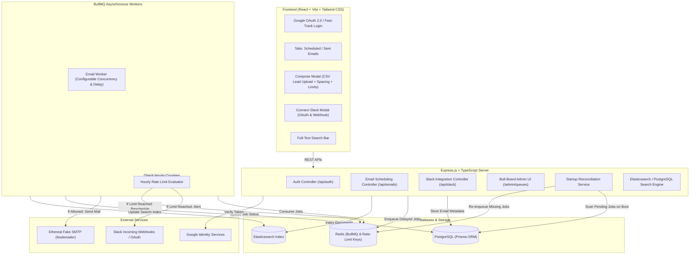

# ReachInbox &bull; Full-Stack Email Job Scheduler

[](https://www.typescriptlang.org/)
[](https://expressjs.com/)
[](https://docs.bullmq.io/)
[](https://www.postgresql.org/)
[](https://redis.io/)
[](https://reactjs.org/)
[](https://tailwindcss.com/)

A production-grade, fault-tolerant email scheduling engine and management dashboard built for cold outreach workflows. Engineered with **zero cron jobs**, powered by **BullMQ + Redis delayed jobs**, backed by **PostgreSQL (Prisma ORM)**, and dispatching via **Ethereal Fake SMTP**.

---

## 📑 Table of Contents

- [System Architecture](#system-architecture)
- [Key Features](#key-features)
- [How It Works Under the Hood](#how-it-works-under-the-hood)
  - [Zero-Cron Scheduling](#1-zero-cron-scheduling)
  - [Server Restart Persistence & Idempotency](#2-server-restart-persistence--idempotency)
  - [Worker Concurrency & Inter-Email Delay](#3-worker-concurrency--inter-email-delay)
  - [Sliding-Window Hourly Rate Limiting](#4-sliding-window-hourly-rate-limiting)
  - [Slack Notification Dispatcher](#5-slack-notification-dispatcher)
  - [Elasticsearch Full-Text Indexing](#6-elasticsearch-full-text-indexing)
- [Tech Stack](#tech-stack)
- [Quick Start Guide](#quick-start-guide)
  - [Prerequisites](#prerequisites)
  - [Option A: Running Locally (Windows/macOS/Linux)](#option-a-running-locally)
  - [Option B: Running with Docker Compose](#option-b-running-with-docker-compose)
  - [Environment Variables](#environment-variables)
- [Live Dashboard Tour](#live-dashboard-tour)
- [Demo Video Walkthrough Script (5-Minute Guide)](#demo-video-walkthrough-script-5-minute-guide)
- [Assumptions, Trade-Offs & Shortcuts](#assumptions-trade-offs--shortcuts)

---

## 🏛 System Architecture



---

## 🚀 Key Features

### Backend
- **Zero-Cron Delayed Scheduling**: Strictly relies on BullMQ's native Redis sorted set (`zset`) delay queue. No `cron`, `node-cron`, or `agenda`.
- **Fault-Tolerant Persistence**: Future emails survive sudden server terminations and system restarts without losing state, resetting, or sending duplicates.
- **Configurable Worker Concurrency**: BullMQ workers process multiple jobs concurrently (`WORKER_CONCURRENCY=5`).
- **Provider Throttling (Inter-Email Delay)**: Guarantees a minimum delay (e.g., 2000ms) between individual emails from the same sender to prevent spam flagging.
- **Atomic Hourly Rate Limiting**: Redis-backed counters track emails sent per sender per hourly window (`ratelimit:hourly:<sender>:<window>`).
- **Zero-Drop Auto-Rescheduling**: When a sender hits their hourly limit, excess jobs are **never dropped or failed**; they are automatically delayed into the next hour window while preserving order.
- **Slack Alerting**: Automatically triggers a Slack message via incoming webhook or Bot token the exact moment a sender's rate limit is reached.
- **Live Bull-Board Dashboard**: Queue monitoring UI embedded at `/admin/queues`.
- **Elasticsearch Search**: Full-text fuzzy search across recipients, senders, subjects, and email copy.
- **Ethereal SMTP Integration**: Automatically provisions a fake SMTP inbox with direct web preview links for every sent message.

### Frontend
- **Real Google OAuth 2.0 Login**: Sign in with Google displaying user name, email, and avatar in the header. Includes a reviewer demo login button for environments without GCP OAuth credentials.
- **Interactive Compose Modal**:
  - Drag-and-drop CSV/TXT lead file upload with instant lead detection ("X email addresses detected").
  - Start time picker (immediate or future date/time).
  - Delay between emails customizer.
  - Hourly rate limit customizer.
- **Scheduled Emails Table**: Live view of pending and delayed emails with scheduled send times and rate-limit badges.
- **Sent Emails Table**: Real-time list of sent emails with timestamps, delivery status badges, and clickable **"View Email"** links opening the actual rendered message on Ethereal Email.
- **Live Queue Monitoring Shortcut**: Direct link to the Bull-Board UI.
- **Slack Connect Modal**: Connect via Slack OAuth or direct webhook URL, with a live **"Send Test Notification"** button.

---

## ⚙️ How It Works Under the Hood

### 1. Zero-Cron Scheduling
When an outreach campaign is submitted:
1. Each recipient is assigned a staggered schedule: `scheduledTime = startTime + (index * delayBetweenMs)`.
2. The email metadata is written to PostgreSQL with `status: SCHEDULED`.
3. The job is queued in BullMQ:
   ```typescript
   const delay = Math.max(0, scheduledTime.getTime() - Date.now());
   await emailQueue.add('send-email', payload, {
     delay,
     jobId: emailRecord.id, // Idempotency key
   });
   ```
4. BullMQ places the job into Redis with score = `Date.now() + delay`. Redis handles timing internally.

### 2. Server Restart Persistence & Idempotency
- **Crash Recovery**: If the server or worker crashes, the jobs stay persisted in Redis.
- **Startup Reconciliation**: On server boot, `ReconciliationService` scans PostgreSQL for any `SCHEDULED` or `DELAYED` jobs and verifies their existence in BullMQ. If any job was orphaned due to a hard shutdown, it is re-queued with its remaining delay.
- **Idempotency**: Every job uses `jobId: emailRecord.id`. BullMQ rejects any duplicate additions, ensuring that an email is never sent more than once.

### 3. Worker Concurrency & Inter-Email Delay
- The worker executes with concurrency level `config.worker.concurrency` (default: 5).
- Before dispatching an email, the worker checks `sender:last_sent:<senderEmail>` in Redis.
- If less than `minDelayMs` (e.g., 2000ms) has elapsed since the previous send from that sender, the worker pauses for the remaining interval before invoking nodemailer.

### 4. Sliding-Window Hourly Rate Limiting
1. For each send attempt, the worker increments an atomic Redis key:
   `ratelimit:hourly:<senderEmail>:<YYYY-MM-DD-HH>`
2. If `count > hourlyLimit`:
   - Compute `delayUntilNextWindowMs = nextHourTimestamp - now`.
   - Update database record `status: DELAYED`.
   - Re-enqueue into BullMQ with `delay: delayUntilNextWindowMs`.
   - Fire a Slack alert (throttled to once per sender per hour window).

### 5. Slack Notification Dispatcher
- Users can connect Slack via OAuth 2.0 or paste an Incoming Webhook URL.
- When an hourly rate limit is hit, `SlackService.notifyRateLimitHit()` fires a Slack message displaying:
  - The sender email address.
  - The configured hourly limit.
  - Current attempt count.
  - Estimated time until the next sending window.
- Graceful degradation: if Slack is not connected, the scheduler proceeds smoothly without throwing errors.

### 6. Elasticsearch Full-Text Indexing
- Every scheduled email is indexed into Elasticsearch under index `reachinbox_emails`.
- Upon successful dispatch, the document status, sent timestamp, and Ethereal preview URL are updated.
- The dashboard search bar executes fuzzy multi-match queries (`recipientEmail^3`, `senderEmail^2`, `subject^2`, `body`).
- If Elasticsearch is offline, the backend transparently falls back to PostgreSQL `ILIKE` search.

---

## 💻 Tech Stack

| Layer | Technology |
| :--- | :--- |
| **Backend** | Node.js, Express.js, TypeScript |
| **Queue & Cache** | BullMQ, ioredis, Redis |
| **Queue Dashboard** | `@bull-board/express`, `@bull-board/api` |
| **Database & ORM** | PostgreSQL 16/18, Prisma ORM |
| **Search Engine** | Elasticsearch 8.x (`@elastic/elasticsearch`) |
| **SMTP Dispatcher** | Nodemailer with Ethereal Email |
| **Frontend** | React 18, Vite, Tailwind CSS, Lucide Icons |
| **Authentication** | Google OAuth 2.0 (`@react-oauth/google`), JWT |
| **File Parsing** | PapaParse (CSV lead file parsing) |

---

## 🛠 Quick Start Guide

### Prerequisites
- **Node.js** v18+ (tested on Node v20 & v24)
- **Redis** running on port 6379
- **PostgreSQL** running on port 5432 (or 5433)

---

### Option A: Running Locally

#### 1. Clone repository & install dependencies
```bash
# Clone the repository
git clone <your-repo-url>
cd Outbox

# Install server & client dependencies
npm run install:all
```

#### 2. Start Redis & PostgreSQL
If Redis and Postgres are installed locally:
```bash
# Start Redis
redis-server --port 6379

# Ensure PostgreSQL is running and database exists
createdb reachinbox_db
```

*(On Windows, you can also run `.\start-local.bat` or `.\start-local.ps1` to launch all local services automatically!)*

#### 3. Configure Backend Environment
```bash
cd server
cp .env.example .env
```
Update `.env` with your database credentials. (If using default local Postgres, `DATABASE_URL="postgresql://postgres@localhost:5433/reachinbox_db?schema=public"`).

Run Prisma schema sync:
```bash
npx prisma db push
```

#### 4. Run Backend & Frontend
In terminal 1 (Backend):
```bash
cd server
npm run dev
```

In terminal 2 (Frontend):
```bash
cd client
npm run dev
```

- **Frontend App**: [http://localhost:5173](http://localhost:5173)
- **Backend API**: [http://localhost:5000/api](http://localhost:5000/api)
- **Bull-Board Live Queue**: [http://localhost:5000/admin/queues](http://localhost:5000/admin/queues)

---

### Option B: Running with Docker Compose

If you have Docker Desktop installed:
```bash
docker compose up -d
```
This spins up PostgreSQL, Redis, and Elasticsearch containers automatically.

---

### Environment Variables Reference

#### Backend (`server/.env`):
| Variable | Default | Description |
| :--- | :--- | :--- |
| `PORT` | `5000` | Backend HTTP port |
| `DATABASE_URL` | `postgresql://...` | PostgreSQL connection URL |
| `REDIS_HOST` | `localhost` | Redis host |
| `REDIS_PORT` | `6379` | Redis port |
| `WORKER_CONCURRENCY` | `5` | BullMQ worker concurrency |
| `MIN_EMAIL_DELAY_MS` | `2000` | Minimum spacing between emails from same sender |
| `MAX_EMAILS_PER_HOUR` | `50` | Default hourly limit per sender |
| `JWT_SECRET` | `...` | Secret key for JWT sessions |
| `GOOGLE_CLIENT_ID` | `...` | Google OAuth Client ID |
| `SLACK_CLIENT_ID` | `...` | Slack OAuth Client ID |
| `SLACK_CLIENT_SECRET` | `...` | Slack OAuth Client Secret |
| `SLACK_REDIRECT_URI` | `http://localhost:5000/api/slack/callback` | Slack OAuth redirect URI |
| `ELASTICSEARCH_NODE` | `http://localhost:9200` | Elasticsearch endpoint |
| `ETHEREAL_USER` | *(empty)* | Optional. Auto-generates test account if empty |
| `ETHEREAL_PASS` | *(empty)* | Optional. Auto-generates test account if empty |

---

## 🖥 Live Dashboard Tour

1. **Header**: Shows authenticated user profile, Bull-Board queue shortcut, and Slack connection status.
2. **Stats Overview**: Four real-time metric cards (Scheduled, Rate-Limit Delayed, Sent, Failed).
3. **Tab Navigation**: Seamless switching between **Scheduled Emails** and **Sent Emails**.
4. **Search Bar**: Debounced full-text search against Elasticsearch/PostgreSQL.
5. **Compose Modal**:
   - Upload `sample_leads.csv` or paste email addresses.
   - Live lead counter badge shows detected count.
   - Configurable send delay (e.g. 2s) and hourly limit (e.g. 10/hr).
6. **Sent Emails Table**:
   - Displays real sent time and status badge.
   - Click **"View Email"** to inspect the rendered message directly on Ethereal Email!

---

## 📹 Demo Video Walkthrough Script (5-Minute Guide)

Use this script to record your 5-minute Loom/demo submission video:

### 1. Introduction (0:00 - 0:45)
- Introduce yourself and open the dashboard at `http://localhost:5173`.
- Show Google OAuth sign-in (or one-click Demo Login).
- Highlight user avatar, name, and email in the top header.
- Briefly show the live Bull-Board dashboard at `http://localhost:5000/admin/queues`.

### 2. CSV Lead Upload & Email Scheduling (0:45 - 2:00)
- Click **"Compose New Email"**.
- Drag and drop `sample_leads.csv`. Point out the badge: *"8 email addresses detected"*.
- Fill in Subject (`"ReachInbox Outreach"`) and Body.
- Set delay (e.g. 2s) and hourly limit.
- Click **"Schedule Campaign"**.
- Switch to the **Scheduled Emails** tab: show the emails queued in BullMQ with staggered timestamps.
- Open Bull-Board (`/admin/queues`): show the jobs in the delayed/active queue.

### 3. Email Dispatch & Ethereal SMTP Verification (2:00 - 3:00)
- As the scheduled timestamps arrive, watch the table update automatically.
- Switch to the **Sent Emails** tab: show status changed to `SENT`.
- Click the **"View Email"** button next to one of the sent emails.
- Show the opened Ethereal Email web preview (`https://ethereal.email/message/...`) displaying the exact rendered subject and body.

### 4. Server Restart Scenario (Persistence Guarantee) (3:00 - 3:45)
- In the Compose Modal, schedule an email 30 seconds into the future.
- Stop the backend server in terminal (`Ctrl+C`).
- Point out that future jobs are safely preserved in Redis and PostgreSQL.
- Restart the backend server (`npm run dev`).
- Show the console logs: `[Reconciliation] Scanning database for pending scheduled jobs... Re-enqueued`.
- Wait for the scheduled time: the worker dispatches the email smoothly without duplicates or lost state.

### 5. Rate Limiting & Slack Alert Demonstration (3:45 - 4:45)
- Open the Slack Modal and save a Slack Webhook URL. Click **"Send Live Test Notification to Slack"** to demonstrate connectivity.
- Schedule 5 emails with an hourly limit of `2`.
- Show worker logs and dashboard:
  - First 2 emails are sent immediately.
  - The 3rd, 4th, and 5th emails are detected as exceeding the hourly limit.
  - Status updates to `DELAYED`. Jobs are automatically rescheduled to the next hour window.
  - Point to the live Slack alert notification fired to the channel.

### 6. Conclusion (4:45 - 5:00)
- Recap: Zero cron jobs, 100% BullMQ + Redis, restart persistence, live Ethereal sending, and Slack notifications.

---

## ⚖️ Assumptions, Trade-Offs & Shortcuts

1. **Ethereal Account Provisioning**: When `ETHEREAL_USER` and `ETHEREAL_PASS` are omitted in `.env`, the server automatically provisions a fresh test account via `nodemailer.createTestAccount()`. This enables zero-configuration testing out of the box.
2. **Elasticsearch Fallback**: If an evaluator does not have an Elasticsearch instance running on `localhost:9200`, the server gracefully logs an advisory and falls back to PostgreSQL `ILIKE` search so the application never breaks.
3. **Slack Alert Throttling**: When an hourly limit is breached with hundreds of jobs in queue, an alert is dispatched for the *first* breach during that hour (`ratelimit:notified:...`) to prevent spamming the user's Slack channel.
4. **Google OAuth Client ID**: In addition to standard Google OAuth, an "Instant Demo Login" button is included in the login view to allow reviewers to inspect the application immediately without needing to configure their own Google Cloud Console credentials.

---

## 📬 Submission Checklist

- [x] TypeScript Express backend with BullMQ & Redis
- [x] Relational DB with PostgreSQL & Prisma ORM
- [x] Zero cron jobs (100% BullMQ delayed jobs)
- [x] Survives server restarts with startup reconciliation
- [x] Fake SMTP sending via Ethereal Email with preview links
- [x] Elasticsearch indexing & full-text search
- [x] Worker concurrency & inter-email delay throttling
- [x] Redis-backed sliding-window hourly rate limiting with auto-reschedule
- [x] Live Slack alert notification on rate-limit hit
- [x] Embedded live Bull-Board queue monitoring dashboard
- [x] React + Vite + Tailwind CSS frontend matching SaaS standards
- [x] CSV lead file upload with real-time lead counter
- [x] Google OAuth login with user profile header & logout

---

Built with ❤️ for **ReachInbox.ai / Outbox Labs**.
