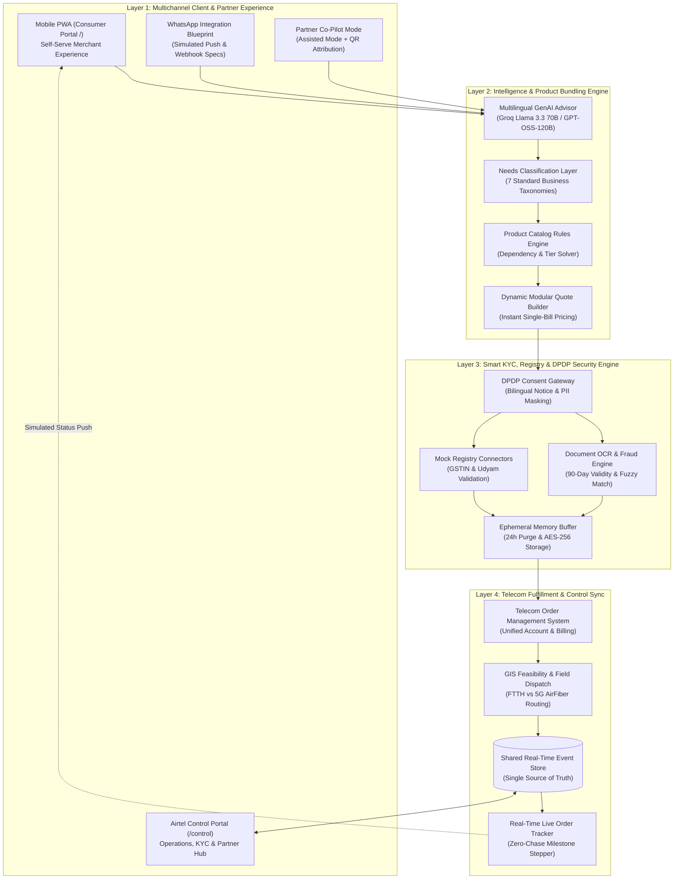
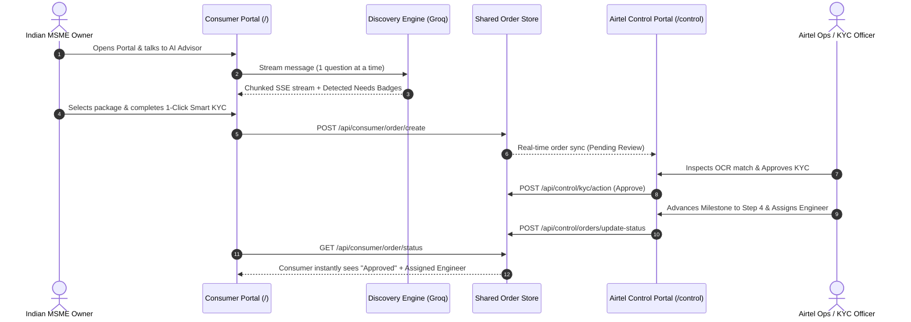
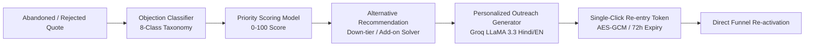
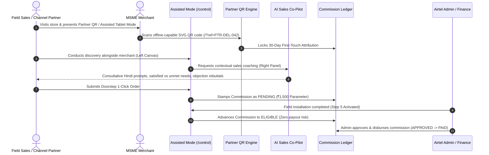
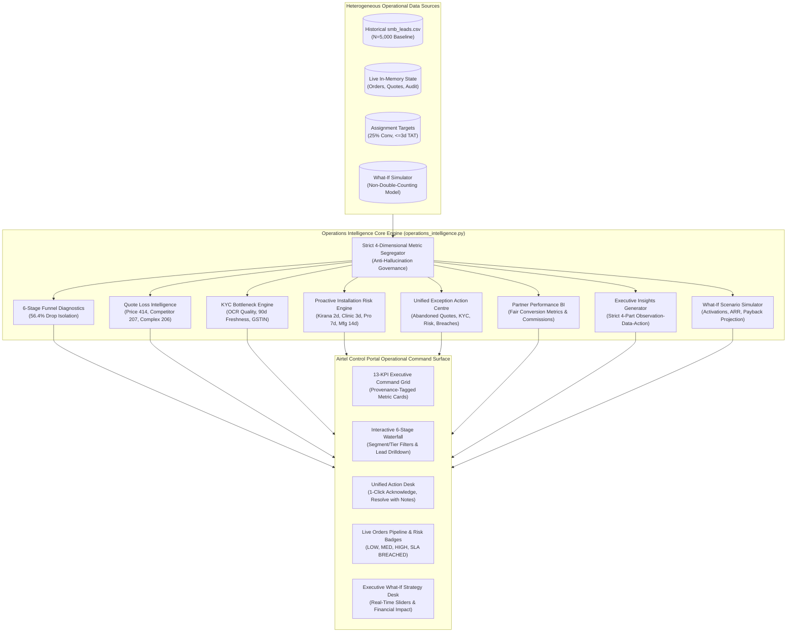

# Solution Architecture & System Data Flows: Project Udyam Digital
**Airtel SYNC 2026 · Digital Track (Enterprise Track A)**  
*Team Halo · Thapar Institute of Engineering & Technology*

---

## 1. System Overview
Project Udyam Digital provides a 4-tier, event-driven, cloud-native architecture designed to process MSME telecom onboarding at scale with sub-second response times, zero manual typing, and complete regulatory compliance.

---

## 2. Layer-by-Layer Architectural Specifications

### Layer 1: Multichannel Experience Layer
* **Consumer Portal (`/`):** Clean, warm off-white, mobile-first web interface designed for non-technical Indian business owners (Kirana shops, medical clinics, CA offices, multi-location retailers, small manufacturing units). Zero internal operational metrics displayed (privacy shielded).
* **Airtel Control Portal (`/control`):** Enterprise slate-themed administrative console for Airtel leadership, operations managers, KYC compliance officers, and channel partners. Provides live funnel analytics, real-time order dispatch, KYC verification queues, and abandoned lead recovery.
* **WhatsApp & Multi-Channel Blueprint:** Architectural integration specification for WhatsApp Business Cloud API webhooks. In this prototype deployment, WhatsApp/SMS interactions are modeled as honest simulated notification streams and human-in-the-loop recovery drafts without requiring external third-party API credentials.
* **Voice Front End (Browser Speech Recognition):** Native browser speech recognition (`hi-IN`, `en-IN`, `pa-IN`) integrated into the Advisor chat bar with typed-input fallback and permission error handling.
* **Partner Co-Pilot (Assisted Mode):** Dedicated tablet dashboard for Airtel's 10,000+ local channel partners and field sales representatives with dynamic SVG QR code attribution and AI propensity scores for lead rescue.

### Layer 2: Intelligence & Product Bundling Engine
* **Multilingual GenAI Advisor:** Dual-mode conversational intelligence service powered by Groq Cloud API (`llama-3.3-70b-versatile`) with an offline-resilient deterministic rules engine fallback ensuring 100% test scenario pass rates without external API dependencies. Adheres strictly to consultative sales discipline: 1 question at a time, 5–25 words per reply, and native Hindi, Punjabi, Hinglish, and English fluency.
* **7-Category Needs Classification Taxonomy:**
  1. *Connectivity:* Business 5G AirFiber / Fiber Broadband (`P04`, `P02`).
  2. *Business Continuity:* 4G/5G Wireless POS Failover (`P09`).
  3. *Security:* Secure Commercial Wi-Fi & DNS Firewall (`P22`, `P21`).
  4. *Communication:* WhatsApp Business API & Cloud Voice (`P10`, `P11`, `P12`).
  5. *Cloud & Productivity:* Cloud Backup 1TB & Google Workspace Suite (`P17`, `P16`).
  6. *Multi-location Networking:* Software-Defined WAN (SD-WAN) & Cloud CCTV (`P23`, `P15`).
  7. *Industrial IoT:* Dedicated 1:1 Leased Line & Machine Telemetry (`P05`, `P24`).
* **Product Catalog Rules Solver:** Programmatic evaluator enforcing business logic from `product_catalogue.csv` (city tier eligibility, minimum employee thresholds, prerequisites).
* **Dynamic Quote Engine:** Computes upfront setup fees and unified monthly charges with live recalculation upon toggling optional add-ons, computing standard 18% GST.

### Layer 3: Smart KYC, Registry & DPDP Security Engine
* **DPDP Consent Gateway:** Presents standalone, unbundled affirmative statutory consent notices under Section 6 of the DPDP Act 2023. The consent checkbox is unchecked by default to require conscious, unambiguous affirmative action before any document bytes are analyzed or transmitted. Implements automated masking of sensitive identifiers (`PAN`, `Aadhaar`, `GSTIN`).
* **Dual KYC Verification Paths:**
  1. *Automated KYC Verification:* Executes multimodal vision extraction and cross-checks with official GSTIN and Udyam registries in real time. If confidence is low, unreadable, or services are unavailable, routes gracefully to manual review without falsely claiming verified status.
  2. *Manual KYC Review:* Enables the customer to submit proof directly to authorized Airtel KYC compliance officers. The application is enqueued in the Airtel Control Portal with safe metadata (no persistent raw image bytes).
* **Mock Registry Connectors:** High-speed query adapters for `mock_gstin_registry.csv` and `mock_udyam_registry.csv`. Returns legal entity names, registered addresses, and active tax compliance flags in under 500ms.
* **OCR & Cross-Field Validator:** Extracts text from uploaded signatory IDs and utility bills. Cross-references address string similarity ($\ge 85\%$) and checks utility bill issue dates against the 90-day validity window (relative to reference date `2026-07-15`).
* **Bidirectional Portal State Synchronizer:** Synchronizes KYC decisions between the Consumer and Control Portals. Officer approvals unlock the customer fulfillment gate; resubmission requests immediately notify the merchant with actionable guidance.
* **Ephemeral Buffer:** Temporary in-memory working cache holding uploaded document pixels during validation, purging unencrypted artifacts within 24 hours.

### Layer 4: Telecom Fulfillment & Self-Serve Tracker
* **Order Management System (OMS):** Automates provisioning across disparate network backends (Broadband OLTs, 5G Core, Cloud SaaS tenant creation), binding them into a single consolidated B2B bill.
* **GIS Feasibility & Workforce Dispatch:** Automatically evaluates line-of-sight AirFiber coverage vs. fixed optical fiber splitter availability and assigns local technicians with route tracking.
* **Live Order Tracker:** Provides merchants with an active 5-step milestone stepper (Order Confirmed $\rightarrow$ KYC Verified $\rightarrow$ Feasibility Cleared $\rightarrow$ Hardware Dispatched $\rightarrow$ Activated), slashing status chase calls from 3.0 to $<0.2$ per customer.
* **Shared In-Memory Event Store:** Acts as the synchronized single source of truth between the Consumer Portal and Airtel Control Portal. Real-time updates by KYC officers or Ops managers instantly reflect on the customer's live tracking view.

---

## 3. Dual-Portal Operating Architecture

The system enforces strict domain and presentation separation:

---

## 4. AI-Powered Quote Recovery Engine Architecture

To directly recover the 1,113 funnel dropouts identified at the quotation acceptance stage, the platform integrates an event-driven recovery engine:

### Key Recovery Engine Components:
1. **8-Class Objection Taxonomy:** Programmatically classifies customer feedback into: `price_too_high`, `competitor_preference`, `technical_complexity`, `missing_product_requirement`, `installation_timeline_concern`, `trust_security_concern`, `not_ready_to_purchase`, and `other_unknown`.
2. **Priority Scoring Algorithm ($0-100$):** Ranks leads dynamically based on Deal Value (weight: 35%), Session Depth & Velocity (weight: 35%), and Objection Recoverability (weight: 30%).
3. **Automated Down-Tiering & Add-on Matching:** If budget is exceeded, recommends alternative lower-cost bundles (e.g. ₹1,999/mo Kirana starter saving ₹1,500/mo) or matches missing add-ons from `product_catalogue.csv` without telecom jargon.
4. **Contextual AI Outreach Generator:** Synthesizes natural, empathetic WhatsApp and email messages in Hindi and English with customized talking points.
5. **Secure Re-Entry Tokens & DPDP Opt-Out:** Merchants resume their saved quotes in one click (`/api/recovery/resume/<token>`). If the customer replies "STOP" or opts out, communications are permanently suppressed under Section 6 of the DPDP Act 2023.

---

## 5. Assisted Digital Partner Ecosystem & Commission Architecture

To empower Airtel's 10,000+ local DTH/broadband channel partners and field sales force without creating channel conflict:

### Key Partner Ecosystem Components:
1. **Strict Role-Based Access Control (RBAC):** Five system roles (`super_admin`, `ops_manager`, `sales_executive`, `channel_partner`, `kyc_officer`). Lead recovery decision desks enforce server-side authorization: only authorized management and sales roles view unmasked customer telephone/contact details and trigger outreach, while partners and read-only viewers receive masked PII. Every recovery record carries explicit provenance tags (`is_seeded: true/false`, `record_origin`) to clearly segregate seeded benchmark examples from live prototype sessions.
2. **Dynamic Branded SVG QR Engine:** Generates lightweight, offline-resilient SVG QR codes (`/api/partner/<id>/qr`) and referral URLs. Implements a 30-day first-touch attribution lock to eliminate partner commission hijacking.
3. **Activation-Gated Commission State Machine:** Standard demonstration parameter: ₹1,500 per activation. Commissions are stamped `pending` at order placement, strictly transitioning to `eligible` only upon Step 5 ("Installation & Service Activated"). Admin authorization is required for `approved` $\rightarrow$ `paid` or `reversed` states.
4. **Dual-Aspect Assisted Mode for Tablets (`#assistedModeModal`):**
   - *Customer-Facing Canvas (Left 60%):* Clean, non-intimidating MSME discovery, transparent 18% GST pricing breakdown, and doorstep KYC. Internal metrics and margins are shielded.
   - *Private Partner AI Co-Pilot (Right 40%):* Live consultative questions in Hindi/Hinglish, customer objection rebuttals, satisfied vs. unmet feature checklists, and ₹1,500 payout terms.
5. **Territory Lead Rescue Desk:** Routes abandoned local quotes from Phase 3 to nearby partners for warm field visits.

---

## 6. Predictive Operations & Operations Intelligence Centre Architecture

### Key Operations Intelligence Components:
1. **Strict 4-Dimensional Segregation:** Mandates absolute provenance separation between Historical Assignment Baseline (N=5,000), Assignment Targets, Live Prototype Transactions, and Simulated Scenarios. Every metric carries an explicit `data_source` tag.
2. **6-Stage Funnel Diagnostics:** Tracks the acquisition journey from Lead Generated (5,000) through Activated (368), mathematically isolating the 56.4% collapse point (1,113 drops) at Stage 3->4 (Needs Assessed to Quote Accepted).
3. **Quote Loss Intelligence:** Categorizes historical quote rejections into Price Too High (414 / 37.2%), Competitor Cheaper (207 / 18.6%), Quote Complex (206 / 18.5%), and Delivery Delays (286 / 25.7%), paired with actionable recommendations and Phase 3 recovery cross-links.
4. **Bundle-Specific Proactive Installation Risk Engine:** Evaluates orders against product-specific SLAs (Kirana 2 days, Clinic 3 days, Multi-site 7 days, Manufacturing 14 days), computing an explainable 0-100 risk score and assigning status (`LOW_RISK`, `MEDIUM_RISK`, `HIGH_RISK`, `SLA_BREACHED`) with root-cause explanations and operational directives.
5. **Unified Exception Management Centre:** Merges 4 distinct operational incident streams (abandoned high-priority quotes, KYC exceptions, installation risks, and unassigned resources) into a single prioritized queue supporting 1-click acknowledgment and resolution with auditable notes.
6. **Executive Business Insights (Strict 4-Part Schema):** Formulates verified insights containing (1) Empirical Observation, (2) Traceable Supporting Data, (3) Business Implication, and (4) Recommended Operational Action.
7. **Interactive What-If Scenario Simulator:** Features a transparent mathematical model without double-counting, projecting net activations, incremental ARR, CAC spend, and payback period from user-adjusted quote acceptance, KYC completion, activation, and recovery rates.

## 7. Key Performance Indicators & Target Impact

| Metric | Baseline (Traditional B2B) | Project Udyam Digital | Improvement Factor |
|---|---|---|---|
| **Customer Onboarding TAT** | 17.6 Days | 3.5 Days | **80.1% Faster** |
| **Customer Acquisition Cost (CAC)** | ₹15,000 | ₹3,800 | **74.7% Reduction** |
| **Lead Conversion Rate** | 7.36% | 22.0% | **3.0x Increase** |
| **Status Chase Calls per Lead** | 3.0 Calls | <0.2 Calls | **93.3% Elimination** |
| **Quote Acceptance Drop-off** | 56.0% Drop | <12.0% Drop | **78.6% Recovery** |

*Submitted on behalf of Team Halo (Thapar Institute of Engineering & Technology) for Airtel SYNC 2026.*
